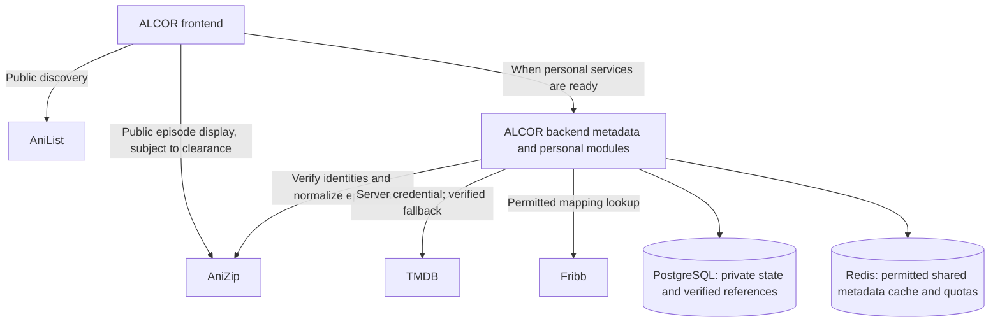

# ALCOR metadata plan update

Date: 25 November 2026. Status: plan with a locally verified browser AniZip episode-display slice. Trusted server episode reconciliation, TMDB enrichment and production provider clearance remain pending.

Authority: owner's three-provider diagram and request to revise the plan. This is an addendum to the original master and editorial plans, which remain unchanged. Google configuration, import, export and personalized recommendation scoring remain deferred. D-SSBP applies: L2 metadata integration, L4 credential/private-state boundaries.

## 1. Objective

Provide useful episode titles, descriptions and thumbnails without making public browsing wait for a sleeping personal backend. Preserve exact episode identity, existing progress and source attribution. Additional providers improve coverage; they do not establish complete or error-free coverage.

## 2. Provider responsibilities

| Feature | Primary | Fallback and boundary |
| --- | --- | --- |
| Home, trending/popular/upcoming, search, anime/manga descriptions | AniList | Public browser requests; errors do not block existing personal records |
| Characters, voices, relations and source suggestions | AniList | Separate bounded requests; source suggestions do not implement deferred personalized scoring |
| Next airing time/countdown | AniList schedule | Preserve timestamp and freshness; calculate countdown in the browser |
| Episode titles, descriptions, historical dates and thumbnails | AniZip | TMDB only for verified matching episodes and missing fields |
| Backdrops, additional artwork and trailers | TMDB | Optional enrichment; keep available AniList artwork when enrichment is missing |
| Series/season/episode mapping | AniZip; Fribb when needed | Validate media type, season and explicit episode ranges; no title-only automatic match |
| Regional legal availability | TMDB | Explicit user-selected region, source links and required attribution; no playback hosting |
| Manga discovery | AniList | AniZip/TMDB do not establish manga chapter coverage; preserve manual chapter tracking |
| Saves, marks, repeats, notes, collections and history | ALCOR API/PostgreSQL | Authenticated, versioned and unavailable until personal services are ready |

TMDB's [season endpoint](https://developer.themoviedb.org/reference/tv-season-details) exposes episode names, overviews, numbers and still paths. These fields are optional in ALCOR; absence is not a failed tracking record.

## 3. Architecture and cold starts

The diagram's backend metadata service remains responsible for trusted normalization, mappings and TMDB access. Direct public reads are a fast path that preserves the owner's earlier cold-start requirement.

- First render: independently load AniList title data and AniZip episode display data. Each section has its own skeleton, error and retry state.
- Backend asleep: public browsing and available AniZip episode details continue. Optional TMDB enrichment may be absent. Saves and tracking remain unavailable; no false success or queued private writes.
- Backend ready: fetch the verified episode mapping, then enable account operations. Never trust browser-supplied source metadata as a write authority.
- Direct AniZip unavailable: retain permitted cached data with a stale label; otherwise show an episode-specific error. Keep the rest of the title page usable.
- If future CORS or usage terms prevent direct AniZip reads, a cache hit behind a sleeping backend is not sufficient. Revisit a separately available metadata proxy/edge service before promising cold-start episode access. That would be a separate hosting/dependency decision, not an automatic new platform.

TMDB's application [read token](https://developer.themoviedb.org/docs/authentication-application) stays in backend secret configuration. It must not appear in Vite variables, browser requests, public bundles, logs or Git. No TMDB account sign-in is needed for public enrichment.

## 4. Identity and episode contract

Freeze the additive API/schema contract before implementation under D-SSBP sections 6.5 and 8.2. Proposed normalized episode fields:

| Field group | Required behavior |
| --- | --- |
| Identity | Immutable ALCOR unit key, canonical title UUID, namespaced provider episode IDs and mapping version |
| Numbering | Preserve original provider key and displayed label as strings; separate season, absolute number and regular/special classification |
| Content | Nullable localized title, overview, thumbnail and runtime; source and retrieval time per supplied field |
| Release | Nullable date/timestamp, precision and source; unknown is distinct from unreleased |
| Coverage | Explicit complete/partial/unknown state, conflict notes and confirmed final total only when supported |

Rules:

1. Never join providers by array position or episode number alone. Preserve exact source keys, including leading zeros, special prefixes and decimal labels.
2. AniList entries and TMDB seasons are not assumed to correspond one-to-one. A split cour or sequel can share a TMDB series; a long-running AniList title can span seasons.
3. Keep TMDB `tv` and `movie` namespaces separate. Store verified season/range/offset relationships in a dedicated mapping structure, not as a unique TMDB-to-title alias in migration 007.
4. Use explicit AniZip/Fribb crosswalk evidence; conflicting or insufficient mappings remain unresolved. Search results can propose a match for review but cannot silently create one.
5. Enrich an existing episode with missing fields only after identity verification. Do not union entire seasons, select the longer provider list or overwrite a valid title merely because a fallback responded.
6. Preserve existing manual/provider sessions and marks. Refreshes cannot renumber or delete tracked units. Any ambiguous manual-to-provider reconciliation needs an explicit review path.
7. Keep specials, recaps and regular episodes distinguishable where source evidence exists. Missing filler/recap classification stays unknown.
8. A date-only value is not a precise release instant. A provider list length or AniList total does not prove complete released coverage. Preserve the existing completion and skip-policy contracts.

Fribb documents [season and episode-offset mappings and distinct TV/movie IDs](https://github.com/Fribb/anime-lists). Its data is evidence to validate, not an instruction to flatten every season into an AniList title.

## 5. Caching, quotas and failures

- Cache only permitted public metadata. Keep account responses private/no-store and out of shared caches.
- Cache keys include provider, media/episode namespace, language, mapping version and region where relevant. Do not cache an ambiguous match as a verified one.
- Deduplicate concurrent requests; request one season or bounded episode batch rather than one network call per visible card. Paginate long runners.
- Honor provider cache headers and 429/Retry-After. Do not treat an unpublished limit as unlimited service or configure recurring catalogue-wide collection.
- Use separate per-provider budgets and cooldowns. A failed TMDB request must not disable AniList or AniZip.
- Permit stale data only within reviewed provider/cache policy; show source, age and partial coverage. Bound retries and negative-cache duration after provider feasibility is established.
- AniList currently documents a temporary [30 requests/minute limit](https://docs.anilist.co/guide/rate-limiting). TMDB describes [variable upper limits and 429 handling](https://developer.themoviedb.org/docs/rate-limiting), not a guaranteed request allowance. AniZip's official quota was not established in this review.

## 6. Delivery order and acceptance

| Step | Focused feature commit | Required evidence |
| --- | --- | --- |
| M0 | Record provider feasibility, permitted use and episode contract | Bounded live samples; usage/cache conditions; mapping cases; secret configuration location; no invented quotas |
| M1 | Add AniZip adapter and normalized episode schema | Pure adapter fixtures for regular/special/unknown fields; ID mismatch and unsafe URL rejection; malformed/429/error handling |
| M2 | Show browser-first episode details | API-off browser test with title and episode data; independent skeleton/error/retry; no private write or token leak; five responsive widths |
| M3 | Verify and persist episode identities | Additive migration and RLS review; exact mapping; conflict refusal; unchanged prior marks/repeats; refresh/idempotency tests on real PostgreSQL |
| M4 | Add optional TMDB fallback | Server-only token; verified season/range mapping; missing-field-only merge; no-key and outage tests; source/attribution checks |
| M5 | Add permitted cache and refresh behavior | Shared singleflight/budgets, stale/negative-cache behavior, source refresh without progress mutation; long-runner pagination |
| M6 | Connect richer tracking and release views | Episode cards, spoiler controls, released/unknown states, existing progress oracle, continue queues, schedule/notification dedup tests |
| M7 | Validate enrichment and release readiness | Artwork/trailers/region-aware availability where supported; accessibility/performance; staged critical flows; human review and release gates |

Each commit includes its relevant tests, concise documentation and actual error-log entries. Do not invent bug-fix commits. Prototype fixtures and live smoke checks are not independent product validation.

Test cases must include a finished single season, split cours, a long runner, specials, an OVA/movie, an upcoming title, absent AniZip mapping, conflicting mappings, missing episode fields and a previously tracked manual session. Expected episode relationships must come from recorded source evidence; selecting familiar title names alone is not an oracle.

## 7. Evidence and open prerequisites

| Item | Evidence on 25 November 2026 | Remaining prerequisite |
| --- | --- | --- |
| AniList | Public GraphQL smoke succeeded with origin header and CORS `*`; existing browser integration implemented | Existing provider-use clearance gate remains open |
| AniZip | `GET https://api.ani.zip/mappings?anilist_id=1` returned 200, CORS `*`, `Cache-Control: public, max-age=900, s-maxage=900`; episode fields and mapping object observed | Confirm official use/cache conditions and quota; test more mapping cases before contract acceptance |
| AniZip root | `/` returned 404 while the mappings endpoint worked | Do not use the root as a health/schema endpoint |
| TMDB | Official season, episode, authentication, image and quota references reviewed; no authenticated API call executed | Backend read token and attribution configuration; live staged mapping samples |
| Provider rights | TMDB documents [noncommercial use with attribution](https://developer.themoviedb.org/docs/faq); required logo/notice belongs in About/Credits | Verify each source's conditions separately; an aggregator does not automatically grant upstream rights |
| Fribb | Primary README documents mapping structure and offsets | Confirm applicable data licence and pinned-source refresh policy before adopting it |

Current implementation: bounded browser AniZip adapter and episode display, additive display fields, source errors, numeric presentation order preserving exact keys, extras, pagination and condensed title details. It deliberately leaves final coverage unknown and does not rewrite private tracking targets. M0 provider conditions, M3 server reconciliation, M4 TMDB and subsequent release work remain open. No production deployment, independent review or full-coverage claim is implied.
